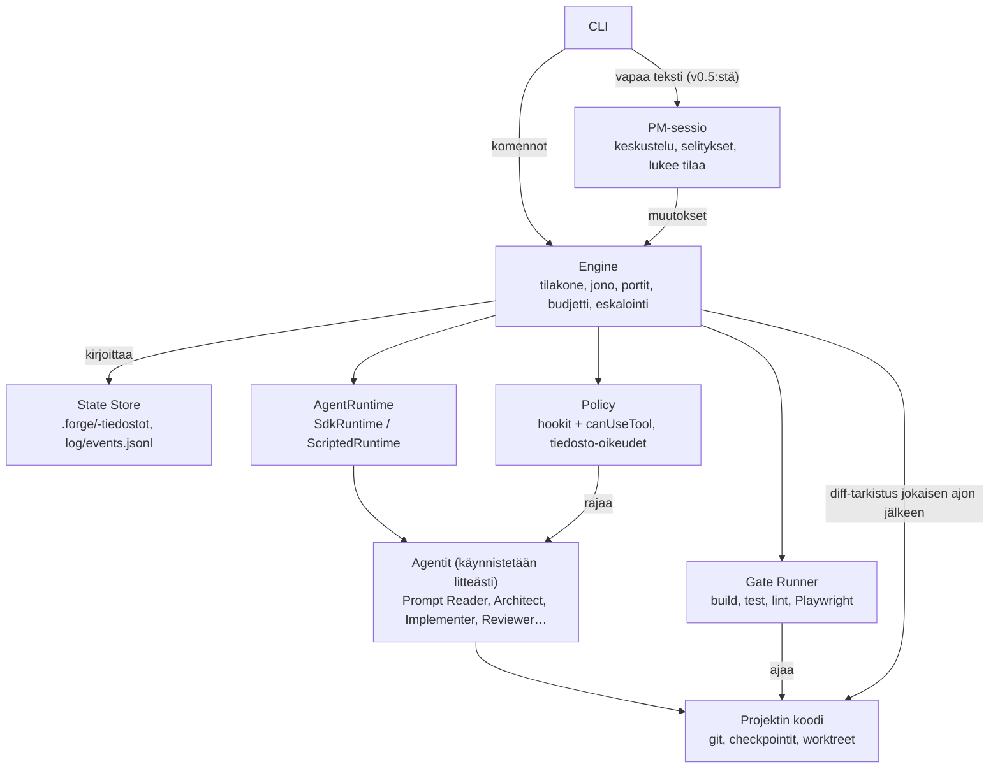
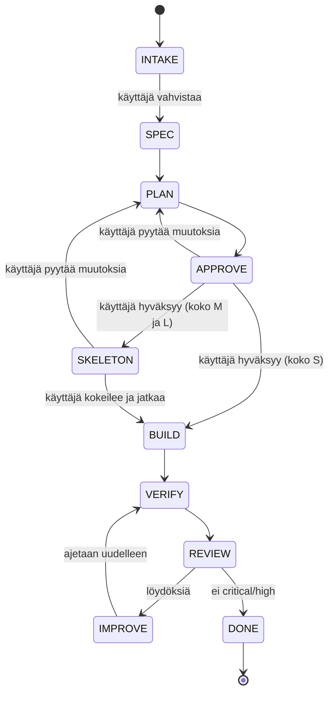

# Forge — tekninen määrittely v1.1

Nov 16, 2026 · @Eino Perämaa · v1.1 päivittää v1:n arvioinnin perusteella, muutokset luvussa 20

## 1. Tarkoitus ja periaatteet

Forge on henkilökohtainen, autonominen ohjelmistokehityksen harness, joka muuttaa yhden hyvin kirjoitetun promptin validoiduksi prototyypiksi. Sen arvo syntyy deterministisestä prosessista, lukituista vaatimuksista, koodissa valvotuista laatuporteista ja mittaamisesta, ei agenttien määrästä.

**Tavoitteet**

- Yhdestä promptista toimiva, testattu prototyyppi, kun vaatimukset on vahvistettu Spec Intake -vaiheessa.
- Suunnitelmat, joissa vaihtoehdot on aidosti tutkittu ja valinta perusteltu (`/plan`, `/plan-hard`).
- Täysi autonomia suunnitelman hyväksynnän ja skeleton-tarkistuksen jälkeen, kovien turvarajojen sisällä.
- Keskustelu PM:n kanssa myös buildin aikana.
- Mitattava hyöty tavalliseen Claude Code -työskentelyyn verrattuna.

**Ei-tavoitteet v1:ssä**

- Web-käyttöliittymä (arkkitehtuuri tukee sitä myöhemmin).
- Usean AI-palveluntarjoajan reititys.
- Itseään muokkaava sääntöjärjestelmä.
- Forgen jakaminen muille käyttäjille omalla tilauksella.

**Suunnitteluperiaatteet**

1. **Ohut ydin, paksu sisältö.** Infrastruktuuria vain sen verran kuin prosessi vaatii; arvo on prompteissa, porteissa ja tietomalleissa.
2. **Prosessi on koodia.** Tilasiirtymät, riippuvuudet, budjetit, portit ja eskalointi toteutetaan TypeScriptillä. LLM tekee harkintaa vaativat työt, ei ohjausta.
3. **Agentit eivät keskustele keskenään.** Ne kommunikoivat rakenteisilla artefakteilla, jotka Engine välittää.
4. **Kriittiset kiellot ovat teknisiä estoja**, eivät prompttiohjeita.
5. **Kaikki mitataan.** Jokaisen mekanismin hyöty todennetaan eval-ajoilla ennen kuin sitä laajennetaan. Jokaisen mekanismin voi kytkeä pois konfiguraatiosta, jotta sen vaikutus voidaan mitata erikseen ja se voidaan poistaa, kun mallit paranevat (luku 14).
6. **Mekanismit syntyvät havaituista virheistä.** Mekanismi lisätään vain, jos se vastaa virheeseen, joka on nähty tavallisen Claude Coden tuloksissa (virheloki, luku 14), tai jos eval osoittaa sen hyödyn.
7. **Tuore konteksti tarkistamiseen, jatkuva konteksti tekemiseen.** Reviewer, Test Author ja tuomarit aloittavat tyhjästä, koska riippumattomuus on niiden arvo. Implementer jatkaa samaa sessiota toisiinsa liittyvien tehtävien yli, koska jokainen kädenvaihto hävittää perusteluja.
8. **Prosessi skaalautuu tehtävän kokoon.** Pieni työ ohittaa vaiheet, joita se ei tarvitse (luku 5).
9. **Käyttäjän huomio on niukin resurssi.** Kysymykset niputetaan, jokaiseen voi vastata yhdellä rivillä, ja käytetty aika mitataan (luku 3).
10. **Läpinäkyvyys kuuluu ytimeen.** Loppuraportista näkee, mikä mekanismi löysi minkä ongelman (luku 13).

## 2. Järjestelmäarkkitehtuuri

Forge erottaa keskustelun ja suorituksen: **PM** on keskusteluagentti, joka ei koskaan aja buildia itse, ja **Engine** on TypeScript-prosessi, joka omistaa tilan, tehtävät ja agenttien käynnistyksen.



PM ei ohjaa agentteja: se lähettää muutokset Enginelle, joka yksinään käynnistää agentit, ajaa portit ja kirjoittaa tilan.

**Komponentit**

| Komponentti | Vastuu | Toteutus |
| --- | --- | --- |
| CLI | Syöte, komennot, tapahtumien näyttö | Rivipohjainen (Node `readline`) v0.1–v0.4, Ink + React v0.5:stä |
| PM-sessio | Keskustelu, selitykset, muutospyynnöt Enginelle | Agent SDK -sessio, oma konteksti (v0.5:stä; sitä ennen komennot menevät suoraan Enginelle) |
| Engine | Tilakone, tehtäväjono, portit, budjetti, eskalointi | TypeScript |
| AgentRuntime | Agenttien suoritus yhden rajapinnan takana | Agent SDK -adapteri + testiadapteri |
| Gate Runner | Deterministiset tarkistukset | Aliprosessit (build, test, lint, Playwright) |
| State Store | Projektin pysyvä tila | Tiedostot `.forge/`-hakemistossa |
| Policy | Työkalu- ja polkurajat | SDK-hookit + `canUseTool`, tiedosto-oikeudet ja ajon jälkeinen diff-tarkistus (luku 12) |

**Säännöt**

- CLI ei koskaan ohjaa agentteja suoraan. Kaikki kulkee Enginen kautta, joten web-UI voidaan myöhemmin lisätä saman tapahtumalokin päälle.
- Engine käynnistää kaikki agentit litteästi. Agenttihierarkiaa ei ole, joten subagenttien sisäkkäisyysrajoite ei koske Forgea.
- PM lukee tilaa ja kirjoittaa vain `ChangeRequest`-olioita. Engine soveltaa ne tehtävien rajakohdissa, ei kesken agenttiajon.
- PM saa poikkeamista ja tuloksista tiiviit yhteenvedot ja viittaukset artefakteihin, ei agenttien keskusteluhistoriaa.

**AgentRuntime-rajapinta**

```ts
interface AgentRuntime {
  run(req: AgentRequest): Promise<AgentResult>;
}

type AgentRequest = {
  role: RoleId;
  model: ModelId;              // konfiguraatiosta, ei kovakoodattu
  promptVersion: string;       // ks. luku 16
  inputs: ArtifactRef[];       // vain tehtävän tarvitsemat artefaktit
  session: "new" | { resume: string };  // tarkistavat roolit aina "new"; Implementer jatkaa (luku 9)
  allowedTools: string[];
  writablePaths: string[];     // tyhjä = read-only
  outputSchema: ZodSchema;     // tulos validoidaan aina
  limits: { maxTurns: number; maxTokens?: number };
};

type AgentResult =
  | { ok: true; output: unknown; usage: Usage; transcriptRef: string;
      sessionId: string; contextUsed: number }   // contextUsed = osuus konteksti-ikkunasta
  | { ok: false; failure: FailureKind; detail: string; usage: Usage };
```

Toteutuksia on kaksi: `SdkRuntime` (oikea Agent SDK) ja `ScriptedRuntime` (ennalta kirjoitetut vastaukset testeihin, ks. luku 15).

## 3. Autentikointi ja käyttörajat

Forge käyttää Claude-tilausta Agent SDK:n kautta. API-avain on vaihdettava varavaihtoehto yhden konfiguraatioarvon takana, koska käytäntö on muuttunut useasti vuoden 2026 aikana.

**Toteutus**

- Agent SDK ajaa Claude Code CLI:tä aliprosessina. Tunnukset tulevat joko `claude login` -kirjautumisesta tai `claude setup-token` -komennon tuottamasta `CLAUDE_CODE_OAUTH_TOKEN`-muuttujasta. Avointa Claude Code -sessiota ei tarvita.
- `forge.config.yaml`: `auth.mode: subscription | api_key`. Engine tarkistaa käynnistyksessä, mitä tunnistetta SDK käyttää, ja näyttää sen `/budget`-näkymässä.
- Tilaus on henkilökohtainen. Forgea ei tarjota muille käyttäjille omilla tunnuksilla, eikä laskutusta kierretä (esim. interaktiivisen CLI:n ajaminen pseudoterminaalissa on kielletty ratkaisu).
- Tarkista käyttöehtojen nykytila ennen toteutusta ja aina, kun Anthropic päivittää niitä: [Use the Claude Agent SDK with your Claude plan](https://support.claude.com/articles/15036540), [Legal and compliance](https://code.claude.com/docs/en/legal-and-compliance).

**Rajatietoinen ajastus**

Tilauksen käyttörajat (5 tunnin ikkuna ja viikkoraja) ovat Forgen todellinen resurssiraja, ei tokenien rahahinta.

1. Engine kirjaa jokaisen agenttiajon käytön (`Usage`) tapahtumalokiin.
2. Kun SDK palauttaa rajavirheen, ajo luokitellaan `rate_limited`-tilaan (ks. luku 10) eikä virheeksi.
3. Engine tekee checkpointin, siirtää projektin tilaan `PAUSED_LIMIT` ja jatkaa automaattisesti, kun raja palautuu, tai käyttäjän `/resume`-komennolla.
4. Kesken jäänyt agenttiajo ajetaan alusta: koodi palautetaan tehtävän checkpointiin, ja Implementerin sessiota jatketaan. Jos jatkaminen ei onnistu, aloitetaan uusi sessio viimeisimmällä siirtomuistiolla (luku 9). Agenttiajot ovat siksi idempotentteja: ne kirjoittavat vain omaan työalueeseensa, ja tulos hyväksytään vasta validoinnin jälkeen.
5. v0.1 ja v0.2 pysähtyvät rajavirheeseen ja jatkavat vain `/resume`-komennolla. Automaattinen jatko tulee v0.3:ssa (luku 18).

**Budjetti**

Budjetti määritellään agenttiajoina ja tokeneina komento- ja vaihekohtaisesti, esimerkiksi `plan.maxAgentRuns: 15`, `plan_hard.maxAgentRuns: 40`, `build.maxImproveRounds: 3`. Ylitys pysäyttää vaiheen hallitusti ja raportoi tilanteen; se ei koskaan jatka hiljaa.

Kokoluokkien M ja L projektit (luku 5) kestävät todennäköisesti usean 5 tunnin ikkunan yli. APPROVE-yhteenvedon käyttöarvio kertoo tämän etukäteen.

**Huomiobudjetti**

Käyttäjän aika budjetoidaan samalla tavalla kuin agenttiajot.

- Kysymykset niputetaan: kerralla näytetään enintään 7 (`attention.maxQuestionsPerStop`), ja jokaisessa on ehdotettu vastaus, jonka voi hyväksyä vastaamalla "ok".
- Eskaloinnit, jotka eivät estä muuta työtä, kerätään ja näytetään yhdessä seuraavassa tehtävän rajakohdassa.
- Engine kirjaa jokaisesta pysähdyksestä kysymysten määrän ja aktiivisen vastausajan (kysymyksen näyttämisestä vastaukseen, enintään 10 minuuttia kysymystä kohti). Luvut näkyvät `/budget`-näkymässä ja loppuraportissa.

## 4. Projektin tila ja tietomallit

Kaikki pysyvä tieto on tiedostoissa projektin `.forge/`-hakemistossa. Tila versioidaan gitissä projektin mukana. Tapahtumaloki ja transkriptit ovat `.forge/log/`-hakemistossa gitin ulkopuolella, jotta `/rollback` ei koske niihin. Agenttien keskusteluhistoria ei ole tilaa; se tallennetaan vain lokiksi.

```
.forge/
  config.yaml           # projektin asetukset, ylikirjoittaa globaalin konfiguraation
  snapshot.md           # tiivis tilannekuva, ladataan PM:lle session alussa
  intake/
    prompt.md           # alkuperäinen prompti muuttamattomana
    questions.json      # Spec Intaken kysymykset, ehdotukset ja vastaukset
  spec.md               # vahvistettu ymmärrys ("rakennamme X, joka tekee Y, ei Z")
  requirements.yaml     # numeroidut vaatimukset, lukitaan APPROVE-vaiheessa
  criteria.yaml         # arviointikriteerit ja ehdottomat rajoitteet suunnittelulle
  conventions.md        # arkkitehdin kirjoittamat koodikonventiot
  plan.md               # hyväksytty suunnitelma
  decisions/ADR-NNN.md  # päätökset, myös hylätyt vaihtoehdot
  arena/<runId>/        # /plan-ajojen ehdotukset, kritiikit, tuomiot, spiket
  tasks.json            # tehtävägraafi ja tilat
  findings.json         # review- ja testilöydökset
  deviations.json       # toteutuksen poikkeamat suunnitelmasta
  handoffs/<n>.md       # Implementerin siirtomuistiot session vaihtuessa (luku 9)
  log/                  # ei gitissä (.gitignore), säilyy rollbackissa
    events.jsonl        # append-only tapahtumaloki
    runs/<runId>.jsonl  # agenttiajojen transkriptit (vain lokiksi)
    metrics.json        # analytiikka, johdetaan tapahtumalokista (luku 14)
```

**Kirjoitusperiaatteet**

- Vain Engine kirjoittaa `.forge/`-tiedostoihin. Agentit palauttavat skeeman mukaisen tuloksen, ja Engine tallentaa sen.
- Kirjoitukset ovat atomisia: kirjoitus väliaikaistiedostoon ja `rename`.
- Jokainen tilamuutos on ensin tapahtuma `events.jsonl`:ssä, sitten muutos tilatiedostoon. Tilan rakentaminen uudelleen lokista toteutetaan v0.3:ssa; sitä ennen luotetaan atomisiin kirjoituksiin.
- Kaikki skeemat määritellään Zodilla `packages/shared/schemas`-paketissa.

**Keskeiset tyypit**

```ts
type Requirement = {
  id: `REQ-${number}`;
  text: string;
  kind: "functional" | "non_functional" | "constraint";
  priority: "must" | "should" | "could";
  acceptance: string[];          // testattavat ehdot
  source: "prompt" | "answer" | "assumption";
};

type Task = {
  id: string;
  title: string;
  goal: string;
  requirementIds: string[];
  dependsOn: string[];
  allowedPaths: string[];       // kirjoitusoikeus näihin ja suunnitelman sharedPaths-polkuihin
  group: string;                // saman ryhmän tehtävät jakavat Implementer-session (luku 9)
  interfacesTouched: string[];  // vaikutusanalyysia varten
  status: "pending" | "ready" | "running" | "blocked" | "needs_update"
        | "verifying" | "done" | "failed" | "escalated" | "cancelled";
  attempts: number;
  planVersion: number;          // minkä suunnitelmaversion mukaan tehty
};

type Finding = {
  id: string;
  severity: "critical" | "high" | "medium" | "low";
  source: "gate" | "review" | "ui_review" | "red_team" | "path_check" | "skeleton_check" | "user";
  mechanism: string;            // löytäneen mekanismin tunniste (luku 14), esim. "gate.acceptance", "reviewer"
  requirementIds: string[];
  location?: string;
  description: string;
  fingerprint: string;          // toistuvuuden tunnistus
  status: "open" | "fixed" | "wont_fix" | "escalated";
};

type Deviation = {
  id: string;
  taskId: string;
  kind: "minor" | "interface" | "data_model" | "requirement";
  observed: string;
  proposal?: string;
  resolution?: { decidedBy: RoleId; adr?: string; affectedTasks: string[] };
};

type ForgeEvent = {
  seq: number;
  ts: string;
  type: string;                 // esim. "task.started", "gate.failed"
  payload: unknown;
};
```

## 5. Tilakone

Projekti etenee enintään kymmenen vaiheen läpi, ja jokaisesta vaiheesta pääsee eteenpäin vain portin kautta. Käyttäjän luo pysähdytään kolmesti: INTAKE-vaiheessa, APPROVE-vaiheessa ja SKELETON-vaiheen lopussa. APPROVE on aina päällä eikä sitä voi ohittaa. Käyttäjä saa ensin yhteenvedon suunnitelmasta, ja toteutus alkaa vasta hänen hyväksyttyään sen. Skeleton-tarkistuksessa käyttäjä kokeilee toimivaa läpileikkausta ennen kuin varsinainen build käyttää budjettinsa. Se on halvin kohta huomata, että suunta on väärä.



Kaavio näyttää pääpolun. Käyttäjän muutospyyntö palauttaa projektin SPEC- tai PLAN-vaiheeseen vain niiltä osin kuin se vaikuttaa, ja erikoistilat on kuvattu alempana.

IMPROVE palaa aina VERIFYyn, joten mikään korjaus ei ohita portteja matkalla DONE-tilaan.

**Kokoprofiilit**

Prosessin raskaus valitaan tehtävän koon mukaan. Prompt Reader ehdottaa kokoa INTAKE-vaiheessa, se näkyy `spec.md`:ssä, ja käyttäjä voi vaihtaa sen.

| Koko | Tunnusmerkit | Suunnittelu | SKELETON | Review |
| --- | --- | --- | --- | --- |
| S | Yksi komponentti, muutama tiedosto, ei käyttöliittymää eikä pysyvää tilaa (esim. CLI-työkalu) | Kevyt suunnitelma (luku 8) | Ohitetaan: konventiot, tehtävät ja hyväksymistestit tehdään APPROVEn jälkeen ilman erillistä vaihetta ja käyttäjän pysähdystä | Reviewer |
| M | Useita komponentteja tai julkinen rajapinta (esim. CRUD-API) | Kevyt suunnitelma tai `/plan` | Kyllä, skeleton-tarkistus | Reviewer |
| L | Käyttöliittymä, API ja tietokanta (esim. pieni SaaS) | `/plan`; `/plan-hard` kalliisiin päätöksiin | Kyllä, skeleton-tarkistus | Reviewer ja UI-review |

Ohitettu vaihe kirjataan tapahtumaksi, ja loppuraportti kertoo käytetyn profiilin.

**APPROVE-yhteenveto**

Yhteenveto mahtuu yhdelle näytölle, ja yksityiskohdat ovat `plan.md`:ssä ja ADR:issä. Se sisältää:

- mitä rakennetaan ja mitä jätetään pois (`spec.md`:n mukaan)
- valitun pinon ja keskeiset arkkitehtuuripäätökset sekä lyhyesti hylätyt vaihtoehdot
- tuomarien erimielisyydet ja muut käyttäjän päätettävät asiat
- tärkeimmät riskit ja tehdyt oletukset
- arvion tehtävien määrästä ja buildin käytöstä

Käyttäjä hyväksyy (`/approve`) tai pyytää muutoksia vapaalla tekstillä. Muutospyyntö palauttaa projektin PLAN-vaiheeseen vain niiltä osin kuin se vaikuttaa, ja uusi yhteenveto näytetään ennen toteutuksen aloittamista.

| Vaihe | Tehtävä | Portti eteenpäin |
| --- | --- | --- |
| INTAKE | Prompt-reader lukee promptin ja kysyy | Käyttäjä hyväksyy `spec.md`:n |
| SPEC | Vaatimukset ja kriteerit | Jokaisella vaatimuksella on ID ja testattava hyväksymisehto |
| PLAN | `/plan` tai `/plan-hard` | `plan.md` ja ADR:t olemassa, ei avoimia critical-riskejä |
| APPROVE | Käyttäjä saa suunnitelmasta yhteenvedon ja hyväksyy sen tai pyytää muutoksia | Hyväksyntä; vaatimukset ja kriteerit lukitaan |
| SKELETON | Walking skeleton, konventiot, hyväksymistestit, skeleton-tarkistus | Skeleton buildaa, testit ajautuvat (saavat epäonnistua), käyttäjä on kokeillut skeletonia ja jatkaa (`/continue`) |
| BUILD | Tehtäväsilmukka graafin mukaan | Kaikki tehtävät `done` |
| VERIFY | Kaikki portit koko projektille | Portit vihreänä, jokainen must-vaatimus katettu |
| REVIEW | Reviewer ja UI-review | Ei avoimia critical- tai high-löydöksiä |
| IMPROVE | Löydösten korjaus, paluu VERIFYyn | Kierrosraja tai löydökset ratkaistu |
| DONE | Loppuraportti | — |

**Skeleton-tarkistus**

Kun skeleton buildaa, Engine pysähtyy ja näyttää yhdellä näytöllä käynnistyskomennon, toteutetun polun ja sen, mitä vielä puuttuu. Käyttäjä kokeilee sovellusta ja jatkaa (`/continue`) tai pyytää muutoksia vapaalla tekstillä. Muutos käsitellään muutospyyntönä: se palauttaa projektin SPEC- tai PLAN-vaiheeseen vain niiltä osin kuin se vaikuttaa. Tarkistus on oletuksena päällä kokoluokissa M ja L, ja sen voi kytkeä pois (`mechanisms.skeletonCheck: false`).

**Erikoistilat**, joihin voi siirtyä mistä tahansa vaiheesta:

- `PAUSED` — `/pause`; jatkuu `/resume`-komennolla samasta kohdasta.
- `PAUSED_LIMIT` — käyttöraja täynnä; jatkuu automaattisesti.
- `AWAITING_USER` — eskalointi käyttäjälle; muut riippumattomat tehtävät jatkavat.
- `STOPPED` — `/stop`; käynnissä oleva agenttiajo saa valmistua tai keskeytetään, ja tila tallennetaan.

**Toteutus**

- Siirtymät ovat puhdas funktio `transition(state, event, profile) → state`, jota testataan ilman agentteja. Kokoprofiili ja mekanismiliput (luku 14) määräävät, mitkä vaiheet ohitetaan.
- Jokainen siirtymä kirjataan tapahtumaksi. Uudelleenkäynnistyksen jälkeen Engine jatkaa viimeisestä tallennetusta tilasta.
- Muutospyyntö (`ChangeRequest`), joka muuttaa vaatimuksia lukituksen jälkeen, palauttaa projektin SPEC- tai PLAN-vaiheeseen vain niiltä osin kuin muutos vaikuttaa (ks. luku 10).

## 6. Roolit ja mallipolitiikka

Forgessa on kahdeksan pysyvää roolia ja neljä suunnittelun ja laadunvarmistuksen apuroolia (Proposer, Critic / Judge, Spike Runner, UI Reviewer), ja jokaisella on oma prompti, työkalurajat, kirjoitusalue ja tulosskeema. Mallit ovat konfiguraatiossa; alla oleva jako on oletus.

| Rooli | Vastuu | Kirjoitusoikeus | Oletusmalli |
| --- | --- | --- | --- |
| PM | Keskustelu, selitykset, muutospyynnöt, tilannekuva | Ei koodia; vain `ChangeRequest` | Opus |
| Prompt Reader | Promptin luenta, kysymykset, oletukset, `spec.md` | Ei | Opus |
| Spec Analyst | Vaatimukset ja arviointikriteerit | Ei (Engine tallentaa) | Opus |
| Architect | Suunnitelma, rajapinnat, konventiot, ADR:t, poikkeamien ratkaisu | Ei koodia | Opus |
| Proposer | Arena-ehdotukset (`/plan`, `/plan-hard`) | Ei | Opus / Sonnet (luku 8) |
| Critic / Judge | Kritiikki, red team, tuomaristo | Ei | Opus |
| Spike Runner | Pienet kokeet väitteiden todentamiseen | Vain `.forge/arena/<runId>/spikes/` | Sonnet |
| Test Author | Hyväksymistestit vaatimuksista ja rajapintasopimuksesta | Vain testihakemistot | Sonnet |
| Implementer | Tehtävän toteutus; jatkaa samaa sessiota tehtäväryhmän yli (luku 9) | Vain tehtävän `allowedPaths` ja `sharedPaths` | Sonnet |
| Reviewer | Diff + vaatimukset tuoreella kontekstilla, tietoturva ja hyväksymistestien pätevyys mukana | Ei | Opus |
| UI Reviewer | Kuvakaappausten arviointi | Ei | Opus |
| Explorer | Olemassa olevan koodikannan analyysi (luku 19), tiivistelmät PM:lle ja Prompt Readerille | Ei | Haiku |

**Säännöt**

- Tarkistava rooli saa vain tehtävänsä tarvitsemat artefaktit (`inputs`). Esimerkiksi UI Reviewer ei näe backend-koodia. Implementer lukee projektin koodin itse; sille ei tiivistetä tiedostoja.
- Implementer ei voi kirjoittaa testihakemistoihin eikä `.forge/`-hakemistoon. Este on tekninen (tiedosto-oikeudet, `canUseTool` ja ajon jälkeinen diff-tarkistus, luku 12), ei prompttiohje.
- Test Author ei näe toteutusta kirjoittaessaan hyväksymistestejä. Se saa vaatimukset ja `plan.md`:n rajapintasopimuksen (komennot, reitit, näkymien polut ja testitunnisteet), jotta testit voivat kutsua oikeaa rajapintaa.
- Reviewer, Test Author ja tuomarit aloittavat aina tyhjällä kontekstilla. Implementer jatkaa sessiotaan tehtäväryhmän sisällä (luku 9).
- Mallivalinta: `models.<role>: opus | sonnet | haiku`. Mallien tarkat tunnisteet ovat yhdessä paikassa, jotta mallipäivitys on yhden rivin muutos.

**Tulosskeemat**

Jokainen rooli palauttaa Zod-skeeman mukaisen JSON-olion. Epäkelpo tulos on virhe `invalid_output` (luku 10), ja sitä yritetään uudelleen kerran validointivirheen kanssa ennen eskalointia.

## 7. Spec Intake

Forge ei etene suunnitteluun ennen kuin käyttäjä ja PM ovat samalla sivulla. Prompt Reader lukee promptin ja liitteet, etsii epäselvyydet, ristiriidat, puutteet ja kohdat, joissa käyttäjä todennäköisesti on ajatellut väärin tai huolimattomasti, ja kysyy niistä.

**Kulku**

1. Prompt Reader tuottaa `questions.json`-tiedoston. Jokaisella kysymyksellä on luokka (`ambiguity`, `contradiction`, `gap`, `likely_mistake`), vaikutus (`architecture`, `scope`, `detail`) ja agentin oma ehdotus vastaukseksi.
2. Kysymykset järjestetään vaikutuksen mukaan. Kerralla näytetään enintään 7 kysymystä; `detail`-tason asioille kirjataan oletus ilman kysymistä.
3. Käyttäjä vastaa vapaasti, hyväksyy ehdotuksen ("ok") tai pyytää Forgea päättämään. Vastaukset voivat synnyttää jatkokysymyksiä, enintään 3 kierrosta.
4. Prompt Reader kirjoittaa `spec.md`:n muodossa "Rakennamme X:n, joka tekee Y:n. Emme tee Z:aa. Oletamme A, B ja C." Samalla se ehdottaa kokoprofiilia (S, M tai L, luku 5) ja perustelee sen yhdellä virkkeellä.
5. Käyttäjä hyväksyy `spec.md`:n. Vasta tämän jälkeen Spec Analyst kirjoittaa `requirements.yaml`- ja `criteria.yaml`-tiedostot.

**Säännöt**

- Jokainen oletus tallennetaan vaatimukseen kentällä `source: assumption`, jotta niitä voidaan seurata myöhemmin (luku 14: "kuinka moni oletus muuttui").
- `likely_mistake`-kysymys perustellaan aina konkreettisesti, esimerkiksi "vaatimus 3 ja 7 ovat ristiriidassa, koska…". Prompt Reader ei kyseenalaista makuasioita.
- Komento `/intake` ajaa vaiheen uudelleen, jos käyttäjä muuttaa promptia.
- Existing Project Mode -tilassa (luku 19) Prompt Reader saa lisäksi Explorerin tiivistelmän nykyisestä koodikannasta ja kysyy myös ristiriidoista sen kanssa.
- Jos vaatimukset edellyttävät konttiajoa (esimerkiksi useita palveluita compose-tiedostolla tai kontitettua julkaisua), Prompt Reader kertoo jo kysymysvaiheessa, että Forge v1 ei todenna konttikonfiguraatiota (luku 12), ja kirjaa tämän riskiksi.

## 8. /plan ja /plan-hard

Suunnittelulla on kolme tasoa. **Kevyt suunnitelma** on oletus: Architect kirjoittaa suunnitelman ja ADR:t, yksi Critic hyökkää sitä vastaan tyhjällä kontekstilla vaatimus-ID:ihin sidotuilla väitteillä, ja Architect päivittää suunnitelman kerran. Se on ainoa taso versioissa v0.1–v0.5, jolloin myös `/plan`-komento ajaa sen, ja kokoluokan S oletus sen jälkeenkin.

`/plan` ja `/plan-hard` toteutetaan Arena-muodossaan v0.6:ssa, ja vain jos eval osoittaa, että suunnitelman laatu rajoittaa lopputulosta (luku 18). Arenalla on Forgen mekanismeista heikoin näyttö ja suurin käyttö, joten se rakennetaan viimeisenä.

Molemmat komennot ajavat saman Arena-pipelinen eri profiililla. `/plan` tuottaa tokenitehokkaan, kritiikin läpäisseen suunnitelman; `/plan-hard` hakee aidosti erilaisia ja epätavallisia vaihtoehtoja ja ratkaisee kiistat kokeilla. Kumpikaan ei kirjoita tuotekoodia.

**Profiilit**

| Asetus | /plan | /plan-hard |
| --- | --- | --- |
| Konventionaaliset ehdottajat | 2 (Opus) | 1 uusi (eri malli kuin baseline) + baseline, jos olemassa |
| Epätavalliset ehdottajat | 0 | 3–4 karkeaa ideaa → 2 kehitetään täysiksi |
| Diversiteettitarkistus | Kyllä | Kyllä, tiukempi kynnys |
| Väittelykierrokset | 1 | 2 |
| Spiket | Ei | Kyllä, empiirisiin kiistoihin |
| Red team -linssit | 1 yleinen | 5 erillistä |
| Tuomarit | 1 | 3 |
| Päätöskohtaiset miniväittelyt | Ei | Kyllä, kiistanalaisille päätöksille |

**Vaiheet**

1. **Lukitse mittari.** `requirements.yaml` ja `criteria.yaml` lukitaan ennen ensimmäistä ehdotusta. Kriteerit sisältävät ehdottomat rajoitteet ja arvioinnin ulottuvuudet: vaatimusten täyttyminen, yksinkertaisuus, ylläpidettävyys, tietoturva, vikatilanteiden kestävyys, UX ja toteutettavuus.
2. **Divergenssi.** Ehdottajat työskentelevät toisistaan riippumatta eivätkä näe baselinea. Konventionaaliset saavat normaalit suunnitteluohjeet. Epätavalliset saavat ohjeen etsiä ratkaisuja, joilla voi erottua edukseen, ja käyttävät yhtä tekniikkaa kukin: rajoitteen purku, inversio, analogia toiselta toimialalta tai radikaali yksinkertaistus. Jokainen ehdotus noudattaa `Proposal`-skeemaa.
3. **Diversiteettitarkistus.** Engine vertaa ehdotusten `keyDecisions`-listoja. Jos kahden ehdotuksen ydinpäätökset ovat samat, toinen generoidaan uudelleen pakotetulla vastakkaisella oletuksella (enintään 2 kertaa).
4. **Väittely.** Engine välittää artefaktit. Kierros 1: kriitikko esittää ehdotuksen ensin parhaassa valossa ja hyökkää sitten; jokainen väite sidotaan vaatimus-ID:hen. Kierros 2 (hard): tekijät vastaavat ja päivittävät ehdotuksensa; lainatut ideat kirjataan.
5. **Spiket (hard).** Empiirinen kiista ("kirjasto X tukee Y:tä", "kysely pysyy alle 100 ms") muutetaan `Claim`-olioksi. Spike Runner kirjoittaa pienen kokeen, ajaa sen ja palauttaa tuloksen todisteeksi. Väite, jota ei voitu todentaa, merkitään riskiksi.
6. **Red team.** Finalistit käyvät läpi linssit: tietoturva, vikatilanteet ja skaalautuminen, ylläpidettävyys, UX-polut, toteutettavuus. Jokainen linssi on oma agenttinsa tyhjällä kontekstilla.
7. **Tuomaristo.** Tuomarit eivät näe väittelyä. He saavat lopulliset ehdotukset nimillä A, B, C…, red team -löydökset ja spike-tulokset. Ehdotukset normalisoidaan samaan pituuteen ja muotoon. Vertailu tehdään pareittain kriteeri kerrallaan molemmissa järjestyksissä, ja jokainen tuomio perustellaan. Tuomarit eivät tiedä, mikä ehdotus on baseline tai epätavallinen. Tuomarien erimielisyys nostetaan käyttäjälle päätettäväksi.
8. **Synteesi.** Architect kirjoittaa lopullisen suunnitelman. Jos se yhdistelee eri ehdotuksia, hybridi ajetaan vielä kerran red teamin läpi.
9. **Tulosteet.** `plan.md`, ADR jokaisesta merkittävästä päätöksestä (myös hylätyt vaihtoehdot ja syyt), avoimet riskit ja yhteenveto: "tutkittu N vaihtoehtoa, M kehitetty täysiksi, K väitettä verifioitu, L avointa erimielisyyttä".

**Baseline ja `/plan-hard`**

- Jos `/plan` on ajettu, sen tulos on yksi kilpailija tuomaristossa. Ehdottajat eivät näe sitä, joten ankkuroitumista ei synny.
- Jos baseline voittaa, hard-ajo ei tuottanut parempaa ratkaisua, ja tämä kirjataan analytiikkaan.
- `/plan` merkitsee päätökset, joissa epävarmuus on suuri ja peruminen kallista, ja ehdottaa niihin `/plan-hard --decision <aihe>`.

**Päätökset ensin kokonaisuutena, sitten erikseen (hard)**

Kokonaiset ehdotukset varmistavat johdonmukaisuuden. Kiistanalaiset ydinpäätökset (tietomalli, autentikointi, palvelurajat, synkroninen vai asynkroninen) käsitellään sen jälkeen omina miniväittelyinään samalla menettelyllä.

```ts
type Proposal = {
  id: string;
  premise: string;                 // lähtöoletus, esim. "yksi deployattava yksikkö"
  stance: "conventional" | "unconventional";  // tuomarit eivät näe tätä
  keyDecisions: { topic: string; choice: string; rationale: string }[];
  dataModel: string;
  components: { name: string; responsibility: string; interfaces: string[] }[];
  requirementCoverage: { reqId: string; how: string }[];
  assumptions: string[];
  risks: string[];
  falsifiers: string[];            // mikä osoittaisi ratkaisun vääräksi
  claims: Claim[];                 // empiiriset väitteet spikeille
};
```

## 9. Build Engine

Build etenee peräkkäin oletuksena. Ensin rakennetaan walking skeleton ja lukitaan rajapinnat, ja vasta sen jälkeen toisistaan riippumattomia lehtitehtäviä voidaan ajaa rinnakkain.

**SKELETON-vaihe**

1. Architect kirjoittaa `conventions.md`:n: virheenkäsittely, nimeäminen, validointi, lokitus, kansiorakenne ja testien sijainti. Tiedosto on lyhyt ja esimerkkipohjainen.
2. Implementer rakentaa walking skeletonin: ohut läpileikkaus koko pinosta (esim. UI → API → tietokanta yhdelle polulle), joka toimii konventioiden referenssitoteutuksena.
3. Test Author kirjoittaa hyväksymistestit vaatimusten ja rajapintasopimuksen pohjalta näkemättä toteutusta. Testien pitää ajautua, ja toteuttamattoman vaatimuksen testin pitää epäonnistua. Ennen toteutusta läpäisevä testi ei mittaa mitään, joten se kirjataan löydökseksi Test Authorille.
4. Architect pilkkoo suunnitelman tehtäviksi (`tasks.json`). Jokaisella tehtävällä on tavoite, vaatimus-ID:t, riippuvuudet, `allowedPaths`, `interfacesTouched`, tehtäväryhmä (`group`) ja hyväksymisehdot. Suunnitelma nimeää lisäksi `sharedPaths`-polut: tiedostot, joita lähes jokainen tehtävä joutuu muuttamaan (esim. `package.json`, lukkotiedosto, reittien tai moduulien indeksi).
5. Skeleton-tarkistus: käyttäjä kokeilee skeletonia ja jatkaa tai pyytää muutoksia (luku 5).

Kokoluokassa S erillistä vaihetta ei ole: Architect kirjoittaa konventiot ja tehtävät osana suunnitelmaa, ja Test Author kirjoittaa hyväksymistestit heti APPROVEn jälkeen.

**Tehtäväsilmukka (BUILD)**

```
for task in graph.ready():
  checkpoint = git.commit("before " + task.id)
  result = runtime.run(Implementer, task, session = sessionFor(task.group), inputs = [plan, conventions, skeleton refs])
  checkPaths(diff(checkpoint), task.allowedPaths + sharedPaths)  # luku 12; rikkomus hylkää ajon
  if result.deviation: handleDeviation(result.deviation)      # luku 10
  gates = runGates(scope = task)                               # luku 11
  if gates.green: task.done(); git.commit(task.id)
  else: classifyAndRetry(task, gates.failures)                 # luku 10
  applyQueuedChangeRequests()                                  # vain tässä rajakohdassa
```

**Implementerin konteksti**

- `plan.md`:n tehtävää koskeva osa, `conventions.md` ja skeletonin referenssitiedostot.
- Implementer lukee muun koodin itse. Sillä on lukuoikeus koko projektiin ja kirjoitusoikeus tehtävän `allowedPaths`- ja `sharedPaths`-polkuihin. Pienemmän mallin tiivistelmiä ei käytetä, koska ne hävittävät yksityiskohtia.
- Hyväksymistestit näkyvät luettavina mutta eivät muokattavina.

**Implementerin sessio**

- Engine avaa yhden Implementer-session tehtäväryhmää kohti ja jatkaa sitä ryhmän tehtävästä toiseen. Uusi tehtävä ja epäonnistuneiden porttien tulokset annetaan samaan sessioon, joten Implementer muistaa aiemmat ratkaisunsa ja sen, mitä se jo kokeili.
- Sessio vaihdetaan, kun ryhmä vaihtuu tai kun session konteksti ylittää rajan (`build.sessionRotateAt`, oletus 60 % ikkunasta). Ennen vaihtoa Implementer kirjoittaa siirtomuistion (`Handoff`: tehdyt ratkaisut perusteluineen, avoimet asiat ja varoitukset seuraavalle). Engine tallentaa sen `.forge/handoffs/`-hakemistoon ja antaa sen uudelle sessiolle.
- Porttien epäonnistuessa Implementer korjaa samassa sessiossa edellisen yrityksen päälle. Koodi palautetaan checkpointiin vasta, kun yritykset loppuvat tai ongelma siirtyy toiselle roolille (luku 10), ja sessiolle kerrotaan palautuksesta.
- Rinnakkaisilla tehtävillä on kullakin oma sessionsa.

**Implementerin havainnointi**

Portit ajetaan tehtävän jälkeen, mutta Implementerin pitää nähdä työnsä tulos jo tehtävän aikana, jotta portit jäävät varmistukseksi.

- Implementer ajaa itse samat porttikomennot kuin Gate Runner (build, typecheck, lint, testit).
- Se saa käynnistää sovelluksen kontissa, kutsua sitä ja lukea sen lokit.
- Käyttöliittymätehtävissä se ottaa kuvakaappaukset samalla Playwright-skriptillä, jota UI-review käyttää (v0.5:stä).
- Mekanismin voi kytkeä pois (`mechanisms.selfObservation`), jotta sen hyöty voidaan mitata.

**Rinnakkaisuus**

- Sallittu vain, kun `build.parallel: true` ja tehtävät ovat lehtitehtäviä, joiden `allowedPaths` eivät mene päällekkäin eivätkä ne koske samoja rajapintoja.
- Jokainen rinnakkainen tehtävä ajetaan omassa git worktreessä.
- Engine yhdistää worktreet yksi kerrallaan ja ajaa portit jokaisen yhdistämisen jälkeen. Konfliktissa myöhempi tehtävä merkitään `needs_update`-tilaan ja ajetaan uudelleen päivitetyn päähaaran päällä. Sama koskee `sharedPaths`-tiedostojen ristiriitoja.
- Oletuksena enintään 3 rinnakkaista tehtävää, jotta käyttörajat eivät täyty nopeasti.

**Johdonmukaisuus**

Reviewer tarkistaa konventioiden noudattamisen erillisenä kohtana. Toistuva konventiorikkomus päivittää `conventions.md`:tä tai skeletonia eikä yksittäistä koodiriviä.

## 10. Poikkeamat, virheluokitus ja eskalointi

Jokainen odottamaton tilanne käsitellään näkyvästi: dokumentaatio päivittyy, tieto kulkee vähintään PM:lle asti, ja ratkaisun suunnittelee siihen tarkoitettu rooli. Korjattavissa olevat ongelmat korjataan suoraan, ja toistuvat ongelmat eskaloidaan, jotta silmukoita ei synny.

**Poikkeamat suunnitelmasta**

1. Implementer havaitsee, että suunnitelma ei toimi sellaisenaan, ja palauttaa tuloksessaan `deviation`-kentän. Se ei kierrä ongelmaa hiljaa.
2. Engine tallentaa `Deviation`-olion ja luokittelee sen:
   - `minor` (tehtävän sisäinen, ei vaikuta rajapintoihin): Implementer ratkaisee itse ja kirjaa ratkaisun.
   - `interface` tai `data_model`: tehtävä pysähtyy, ja Architect tekee minipäätöksen ja kirjoittaa ADR:n.
   - `requirement` (vaatimus on mahdoton tai ristiriitainen): Architect ehdottaa ratkaisua, ja se eskaloidaan käyttäjälle, koska vaatimukset ovat lukitut.
3. Engine tekee vaikutusanalyysin tehtävägraafista. Kaikki tehtävät, joiden `interfacesTouched` kattaa muuttuneen rajapinnan, merkitään `needs_update`-tilaan. Valmiit tehtävät tarkistetaan uudelleen, ja käynnissä olevat saavat päivityksen seuraavassa rajakohdassa.
4. `plan.md` ja `conventions.md` päivitetään, ja `planVersion` kasvaa.
5. PM saa tiiviin yhteenvedon ("poikkeama: X, ratkaisu: Y, vaikutus: Z tehtävää") ja näyttää sen käyttäjälle tapahtumana.

**Virheluokitus**

| Luokka | Tunnistus | Toimenpide |
| --- | --- | --- |
| `code_error` | Portti epäonnistuu, virhe koodissa | Implementer korjaa virheviestin kanssa |
| `flaky_test` | Sama testi menee läpi uudelleenajossa ilman muutoksia | Merkintä, Test Author korjaa testin |
| `environment` | Riippuvuuden asennus, portti, verkko, työkalu puuttuu | Ympäristökorjaus (oma prompti), ei koodimuutosta |
| `invalid_output` | Agentin tulos ei läpäise skeemaa | 1 uusintayritys validointivirheen kanssa |
| `path_violation` | Ajon jälkeinen diff sisältää muutoksia sallittujen polkujen ulkopuolella | Ajo hylätään ja koodi palautetaan checkpointiin; agentti saa listan kielletyistä poluista. Jos muutos oli tarpeen, se palautetaan poikkeamana |
| `rate_limited` | SDK:n rajavirhe | `PAUSED_LIMIT`, ks. luku 3 |
| `plan_defect` | Korjaus vaatisi suunnitelman muutoksen | Käsitellään poikkeamana |
| `stuck` | Sama `fingerprint` toistuu N kertaa | Eskalointi |

Luokittelu tehdään ensisijaisesti deterministisesti (exit-koodit, virheviestien mallit, uudelleenajo). LLM-luokittelua käytetään vain, kun säännöt eivät riitä.

**Eskalointiportaat**

1. Sama rooli yrittää uudelleen, enintään `maxAttempts` (oletus 3).
2. Jos löydöksen `fingerprint` toistuu 2 kertaa, ongelma siirtyy roolille, joka voi ratkaista sen: Architect, jos vika on suunnitelmassa; Test Author, jos vika on testissä.
3. Jos sekään ei auta, tehtävä siirtyy `escalated`-tilaan, käyttäjä saa kysymyksen, ja riippumattomat tehtävät jatkavat. Kysymyksessä on aina ehdotettu ratkaisu, jonka voi hyväksyä yhdellä rivillä, ja samaan aikaan avoimet eskaloinnit näytetään yhdessä (huomiobudjetti, luku 3).

`fingerprint` muodostetaan virheluokasta, tiedostopolusta ja normalisoidusta virheviestistä, jotta sama ongelma tunnistetaan, vaikka rivinumero muuttuu.

Virheluokitus, eskalointiportaat ja poikkeamaprosessi toteutetaan v0.3:ssa. Sitä ennen Engine yrittää tehtävää uudelleen enintään `maxAttempts` kertaa ja pysähtyy sitten kysymään käyttäjältä. `path_violation` on käytössä v0.1:stä alkaen.

## 11. Laatuportit, testit ja review

Laatu varmistetaan kolmella kerroksella: deterministiset portit, riippumaton review ja UI-review kuvakaappauksista. Projekti on valmis vasta, kun kaikki kolme ovat läpäisseet.

**Deterministiset portit**

| Portti | Ehto | Ajetaan |
| --- | --- | --- |
| build | Projekti kääntyy | Jokaisen tehtävän jälkeen |
| typecheck | Ei tyyppivirheitä | Jokaisen tehtävän jälkeen |
| lint | Ei virheitä (varoitukset sallittu) | Jokaisen tehtävän jälkeen |
| unit | Tehtävän testit läpäisevät | Jokaisen tehtävän jälkeen |
| acceptance | Hyväksymistestit läpäisevät | VERIFY-vaiheessa ja kun tehtävän vaatimus-ID:t kattavat testin |
| e2e | Playwright-smoke keskeisille poluille | VERIFY-vaiheessa |
| traceability | Jokaisella `must`-vaatimuksella on vähintään yksi läpäisevä testi, joka epäonnistui ennen toteutusta | VERIFY-vaiheessa |
| audit | Ei tunnettuja critical-haavoittuvuuksia riippuvuuksissa | VERIFY-vaiheessa |

Porttien komennot tulevat suunnitelmasta (`plan.md`: `gates:`), koska ne riippuvat valitusta pinosta. Engine tarkistaa SKELETON-vaiheessa, että jokainen komento on ajettavissa.

**Testien suojaus**

- Hyväksymistestit kirjoitetaan ennen toteutusta vaatimuksista, ja ne ovat Implementerille kirjoitussuojattuja.
- Test Author saa muuttaa hyväksymistestiä vain, jos testi on todistetusti väärä vaatimukseen nähden (`flaky_test` tai virhe testissä). Muutos kirjataan ja näytetään loppuraportissa.
- Hyväksymiskriteerejä ei muuteta sen vuoksi, että toteutus ei täytä niitä.
- Läpäisevä testi ei vielä todista vaatimusta. Engine kirjaa jokaisesta hyväksymistestistä, että se epäonnistui ennen toteutusta, ja Reviewer vertaa jokaista testiä vaatimuksen hyväksymisehtoihin. Testi, joka ei oikeasti tarkista ehtoa, on `high`-löydös Test Authorille.

**Review**

- Reviewer saa diffin, hyväksymistestit, `requirements.yaml`:n, `conventions.md`:n ja relevantit ADR:t tyhjällä kontekstilla. Se ei näe Implementerin keskustelua.
- Tarkistuslista: vaatimusten täyttyminen, hyväksymistestien pätevyys, konventiot, tietoturva (syötteiden validointi, autentikointi, salaisuudet), virheenkäsittely ja tarpeeton monimutkaisuus.
- Löydökset palautetaan `Finding`-olioina vakavuusluokkineen.

**UI-review**

- Playwright ottaa kuvakaappaukset `plan.md`:ssä määritellyistä keskeisistä näkymistä leveyksillä 390, 768 ja 1440 px.
- UI Reviewer arvioi kuvat design-speksiä ja käyttäjäpolkuja vasten. Painopiste on renderöintivirheissä: ylivuoto, päällekkäisyydet, hajoava mobiiliasettelu, heikko kontrasti ja puuttuvat tilat (tyhjä, lataus, virhe).
- Tarkistus on kevyt: yksi ajo REVIEW-vaiheessa ja uusi ajo vain muuttuneille näkymille. Implementer on nähnyt samat kuvakaappaukset jo tehtävän aikana (luku 9), joten UI-review on riippumaton varmistus eikä ensimmäinen katse.

**IMPROVE-silmukka**

- `critical` ja `high` korjataan aina. `medium` korjataan, jos korjaus on rajattu yhteen tehtävään. `low` kirjataan loppuraporttiin.
- Silmukka päättyy, kun avoimia `critical`- tai `high`-löydöksiä ei ole, kun `build.maxImproveRounds` täyttyy tai kun sama löydös toistuu (eskalointi, luku 10).
- Jokaisen korjauksen jälkeen VERIFY ajetaan kokonaan uudelleen, jotta korjaus ei riko muuta.

## 12. Turvallisuus, eristys ja checkpointit

Täysi autonomia on sallittu vain eristetyssä ympäristössä. Projektin sisällä Forge saa tehdä lähes mitä tahansa; projektin ulkopuolelle vaikuttavat toimet vaativat hyväksynnän.

**Eristys**

- Engine ja agentit ajetaan devcontainerissa tai Docker-kontissa. Projektihakemisto liitetään konttiin; isännän kotihakemisto ei näy.
- Verkkoliikenne kulkee sallittujen osoitteiden listan kautta: pakettirekisterit, Anthropicin palvelut ja suunnitelmassa erikseen nimetyt dokumentaatiosivustot. Lista toteutetaan v0.3:ssa. v0.1 ja v0.2 eristävät tiedostojärjestelmän mutta eivät verkkoa, ja loppuraportti kertoo tämän.
- Salaisuudet: kontissa on vain Forgen oma `CLAUDE_CODE_OAUTH_TOKEN`. Projektin tarvitsemat salaisuudet ovat `.env.example`-pohjia, ei oikeita arvoja.
- Agentit ajetaan kontissa eri käyttäjänä kuin Engine. Engine asettaa tiedosto-oikeudet roolin mukaan ennen jokaista ajoa: `.forge/` on agenteille aina vain luettavissa, ja testihakemistot ovat kirjoitettavissa vain Test Authorille.

**Käynnistys: `forge`-komento**

Koko Forge, myös CLI, ajetaan kontissa. Käyttäjän koneella on vain pieni käynnistyskomento `forge` (`bin/forge`), joten kontti on käyttäjälle näkymätön yksityiskohta.

1. Komento tarkistaa, että Docker on käynnissä, ja antaa muuten selkeän virheilmoituksen.
2. Se käynnistää Forgen kontin, jos se ei ole jo käynnissä. Kontti jää taustalle, jotta seuraava käynnistys on lähes välitön.
3. Se liittää nykyisen kansion konttiin projektiksi.
4. Se avaa Forgen CLI:n kontin sisällä samaan terminaaliin ja välittää komentorivin argumentit sellaisenaan.

OAuth-token luodaan kerran käyttäjän koneella komennolla `claude setup-token`, ja `forge` välittää sen kontille ympäristömuuttujana. Selainkirjautumista kontin sisällä ei tarvita.

**Rakennettavan ohjelmiston kontit (v1-rajaus)**

Forge ei aja kontteja oman konttinsa sisällä v1:ssä. Docker-socketin jakaminen tai privileged-tila kumoaisi eristyksen, joten ne on kielletty.

- Rakennettavan sovelluksen palvelut, kuten tietokanta, ajetaan prosesseina Forgen kontissa. Tarvittavat palvelimet asennetaan kontin kuvaan tai SKELETON-vaiheessa kontin sisällä.
- Agentit saavat kirjoittaa Dockerfilen ja compose-tiedoston artefakteiksi, mutta niitä ei rakenneta eikä ajeta.
- Loppuraportti kertoo, että konttikonfiguraatiota ei ole todennettu.
- Konttien todentaminen lisätään myöhemmin omana porttinaan (luku 19).

**Tekniset estot (hookit ja `canUseTool`)**

| Toiminto | Käytäntö |
| --- | --- |
| Kirjoitus tehtävän `allowedPaths`- ja `sharedPaths`-polkujen ulkopuolelle | Estetty `canUseTool`-tarkistuksella; ajon jälkeinen diff-tarkistus hylkää ajon |
| Kirjoitus testihakemistoihin (Implementer) tai `.forge/`-hakemistoon (kaikki agentit) | Estetty tiedosto-oikeuksilla ja diff-tarkistuksella |
| `rm -rf`, `git push`, `git reset --hard`, levyn ulkopuoliset polut | Estetty |
| Riippuvuuden lisäys | Sallittu; kirjataan ja ajetaan audit-portti |
| Deploy, julkaisu, ulkoiset API-kutsut, joilla on sivuvaikutuksia | Vaatii käyttäjän hyväksynnän |
| Budjetin ylitys | Pysäyttää vaiheen |

Jokainen estetty toiminto kirjataan tapahtumaksi, ja agentti saa selkeän virheviestin, jotta se voi valita toisen tavan.

**Ajon jälkeinen diff-tarkistus**

`canUseTool` ja komentojen mallintunnistus eivät yksin riitä, koska shell-komennolla voi kirjoittaa mihin tahansa (`echo > tests/x`, skripti, paketin asennuskoukku). Siksi Engine vertaa jokaisen agenttiajon jälkeen työpuuta checkpointiin (`git status` ja diff). Jos jokin muuttunut polku on sallittujen polkujen ulkopuolella, ajo hylätään, koodi palautetaan checkpointiin ja agentti saa listan rikkomuksista (`path_violation`, luku 10). Tarkistus on deterministinen eikä riipu siitä, millä työkalulla muutos tehtiin. Komentoestot (`rm -rf`, `git push`) ovat lisäsuoja; varsinainen raja on kontti.

**Checkpointit ja palautus**

- Engine tekee git-commitin ennen ja jälkeen jokaisen tehtävän sekä jokaisen vaiheen vaihtuessa.
- `/rollback <checkpoint>` palauttaa koodin ja versioidun `.forge/`-tilan samaan pisteeseen. Tapahtumaloki ja transkriptit ovat gitin ulkopuolella (`.forge/log/`), joten ne säilyvät, ja palautus kirjataan lokiin.
- Implementer korjaa porttivirheet ensin edellisen yrityksen päälle. Kun yritykset loppuvat tai ongelma siirtyy toiselle roolille, tehtävä palautetaan automaattisesti edelliseen checkpointiin, jotta epäonnistuneet yritykset eivät kasaannu.

## 13. CLI, komennot ja keskustelu buildin aikana

CLI on aina valmis ottamaan vastaan viestejä, myös Enginen ajaessa buildia taustalla. Komennot ohjaavat Engineä; vapaa teksti menee PM:lle. Versioissa v0.1–v0.4 CLI on rivipohjainen ja Engine ajaa edustalla, joten komennot toimivat pysähdyksissä ja tehtävien rajakohdissa. Taustalla ajava Engine, PM-keskustelu ja alla kuvattu näkymä tulevat v0.5:ssä.

**Komennot**

| Komento | Toiminta | Kuka hoitaa |
| --- | --- | --- |
| `/intake` | Spec Intake alusta tai uudelleen | Engine |
| `/plan [--decision <aihe>]` | Tokenitehokas suunnitelma | Engine |
| `/plan-hard [--decision <aihe>]` | Laaja vaihtoehtojen haku ja todistaminen | Engine |
| `/approve` | Hyväksyy suunnitelman yhteenvedon, lukitsee vaatimukset ja käynnistää toteutuksen | Engine |
| `/continue` | Hyväksyy skeleton-tarkistuksen ja käynnistää buildin | Engine |
| `/build` | SKELETON → DONE | Engine |
| `/review` | Erillinen review nykyiselle koodille | Engine |
| `/explain [aihe]` | Selitys tilan, ADR:ien ja koodin pohjalta | PM (edullinen malli) |
| `/status` | Vaihe, tehtävät, aktiiviset agentit | Engine (tapahtumaloki) |
| `/tasks` | Tehtävägraafi ja tilat | Engine |
| `/decisions` | ADR-luettelo | Engine |
| `/budget` | Käyttö vaiheittain, rajatila, autentikointitapa | Engine |
| `/pause`, `/resume`, `/stop` | Ohjaus | Engine |
| `/rollback <checkpoint>` | Palautus | Engine |
| `/metrics` | Analytiikka (luku 14) | Engine |

**Keskustelu buildin aikana**

1. CLI lähettää vapaan tekstin PM-sessiolle. PM saa kontekstiksi `snapshot.md`:n ja viimeisimmät tapahtumat, ei koko projektia.
2. PM vastaa kysymyksiin suoraan tilan pohjalta.
3. Jos viesti muuttaa jotain ("tee käyttöliittymästä mobiiliystävällinen"), PM kirjoittaa `ChangeRequest`-olion: muutoksen kuvaus, luokka (`acceptance_criteria`, `requirement`, `priority`, `scope`) ja arvio vaikutuksesta.
4. Engine jonottaa pyynnön ja soveltaa sen seuraavassa tehtävän rajakohdassa. Vaatimusmuutos lukituksen jälkeen käy Spec Analystin ja tarvittaessa Architectin kautta.
5. PM kertoo käyttäjälle, milloin muutos otettiin käyttöön ja mihin tehtäviin se vaikutti.

**Näkymä**

- Yläosassa vaihe, aktiiviset agentit ja käyttörajan tila. Keskellä keskustelu ja tiivistetyt tapahtumat. Alhaalla syötekenttä.
- Tapahtumat näytetään tiivistettyinä ("T-07 valmis, portit vihreänä"). Yksityiskohdat saa komennoilla.
- Ilmoitus näytetään vain, kun käyttäjältä tarvitaan jotain tai vaihe vaihtuu.

**Loppuraportti (DONE)**

Toteutetut vaatimukset ja niiden testit, avoimet `medium`- ja `low`-löydökset, tehdyt oletukset, poikkeamat ja niiden ratkaisut, muutetut hyväksymistestit, käyttö vaiheittain, todentamattomat osat (esimerkiksi konttikonfiguraatio) sekä ohjeet sovelluksen käynnistämiseen.

Raportissa on lisäksi taulukko **Mikä löysi minkä**: jokainen ajon aikana löydetty ongelma ja mekanismi, joka sen löysi (portti, hyväksymistesti, Reviewer, diff-tarkistus, skeleton-tarkistus tai käyttäjä). Raportti kertoo myös käyttäjän huomion (pysähdykset, kysymykset, aktiivinen vastausaika), käytetyn kokoprofiilin ja mekanismiliput. Raportin pitää yksin riittää kertomaan, mikä osa Forgesta ansaitsi paikkansa tässä ajossa. Muuten eval-luvuista näkee, voittiko Forge, mutta ei sitä, mitä pitäisi muuttaa.

## 14. Analytiikka ja eval-ajot

Forge mittaa jokaisesta projektista, toimivatko sen mekanismit, ja vertaa itseään säännöllisesti tavalliseen Claude Codeen. Ilman näitä lukuja ei tiedetä, tuottaako orkestrointi parempia ohjelmistoja vai vain enemmän agenttien toimintaa.

**Projektikohtaiset mittarit (`metrics.json`)**

| Alue | Mittari |
| --- | --- |
| Intake | Kysymysten määrä; oletusten määrä; myöhemmin muutettujen oletusten määrä |
| Arena | Ehdotusten määrä ja tyyppi; voittajan tyyppi (konventionaalinen, epätavallinen, baseline, hybridi); epätavallisista ehdotuksista lopulliseen suunnitelmaan päätyneet päätökset; tuomarien erimielisyydet; spikejen tulokset |
| Typicality | Kuinka usein voittaja on tyypillisin ratkaisu (konventionaalinen ehdotus tai baseline) |
| Hard-hyöty | Poikkesiko `/plan-hard`-tulos olennaisesti baselinesta (eri ydinpäätökset) |
| Build | Poikkeamien määrä luokittain; `planVersion`-muutokset; tehtävien uusintayritykset; eskaloinnit |
| Laatu | Löydökset vakavuuksittain ja lähteittäin; IMPROVE-kierrokset; muutetut hyväksymistestit |
| Käyttö | Agenttiajot ja tokenit vaiheittain ja rooleittain; `PAUSED_LIMIT`-tauot; kokonaisaika |
| Käyttäjä | Käyttäjän väliintulot (vastaukset, eskaloinnit, muutospyynnöt); pysähdysten määrä ja aktiivinen vastausaika |
| Mekanismit | Löydökset mekanismeittain (`Finding.mechanism`); mekanismit, jotka eivät löytäneet mitään; ajossa käytetyt mekanismiliput |

`/metrics` näyttää nykyisen projektin luvut ja kaikkien projektien yhteenvedon, esimerkiksi "epätavallinen ehdotus voitti 2/11 ajossa ja antoi päätöksiä 6/11 ajossa".

**Virheloki ja mekanismirekisteri**

- Ennen Enginen rakentamista (v0.0, luku 18) tavallisella Claude Codella ajetaan 5–6 oikeaa promptia. Jokainen tapa, jolla tulos jäi vajaaksi, kirjataan `evals/failures.md`-tiedostoon: mitä pyydettiin, mitä saatiin ja mikä puuttui tai oli väärin.
- `evals/mechanisms.md` listaa jokaisen mekanismin: mihin virhelokin virheeseen se vastaa, mikä lippu sen kytkee ja mikä eval-tulos sitä tukee. Mekanismi, jolla ei ole riviä virhelokissa, ei pääse versioon ennen kuin eval osoittaa sen hyödyn.

**Mekanismiliput**

```yaml
mechanisms:
  critic: true             # kevyen suunnitelman kritiikki
  testFirst: true          # hyväksymistestit ennen toteutusta
  reviewer: true
  skeletonCheck: true      # käyttäjän pysähdys skeletonin jälkeen
  selfObservation: true    # Implementer ajaa ja katsoo sovellusta itse
  sessionContinuity: true  # Implementer jatkaa sessiota tehtäväryhmässä
  uiReview: true
```

Liput ovat `forge.config.yaml`:ssa, ja jokaisen ajon liput tallennetaan tuloksiin. Turvarajat (luku 12) ja APPROVE eivät ole lippuja. Kun malli vaihtuu, ablaatioajot toistetaan, ja mekanismi, joka ei enää paranna tulosta, poistetaan.

**Eval-ajot**

- Vertailuspeksit `evals/specs/`: CLI-työkalu, CRUD-API, pieni SaaS-sovellus ja (v0.4:stä) muutos olemassa olevaan projektiin. Jokainen speksi kiinnittää ulkoisen rajapinnan (käynnistyskomento, komennot, reitit, portti), jotta eri pinoilla tehtyjä toteutuksia voi testata samalla tavalla. Speksissä on myös valmiit vastaukset intake-kysymyksiin (`answers.md`), jotta toistot ovat vertailukelpoisia.
- **Piilotettu hyväksymistestisarja.** Jokaisella speksillä on `evals/hidden/<speksi>/`-hakemistossa mustan laatikon testisarja, joka kirjoitetaan speksin vaatimuksista ennen ensimmäistä ajoa. Mikään vertailtava haara ei näe sitä, eikä sitä liitetä konttiin. Sen läpäisyaste on ensisijainen mittari. Forgen omien porttien läpäisy ei ole vertailumittari, koska Forge kirjoittaa omat testinsä.
- **Kolme haaraa:** (A) tavallinen Claude Code alkuperäisellä promptilla, (B) tavallinen Claude Code hyväksytyllä `spec.md`:llä ja (C) Forge. A:n ja B:n ero mittaa Spec Intaken hyödyn, B:n ja C:n ero orkestroinnin hyödyn.
- **Toistot:** vähintään 3 ajoa haaraa ja speksiä kohti. Tuloksista raportoidaan mediaani ja vaihteluväli. Ero, joka on pienempi kuin haaran oma vaihteluväli, ei ole tulos.
- **Ablaatio:** kun mekanismin pitämisestä päätetään, Forge ajetaan yhdellä speksillä kyseinen lippu pois päältä ja tulosta verrataan täyteen ajoon.
- Lisäksi mitataan sokkoreviewerin löydökset (reviewer ei tiedä, mikä haara tuotti koodin), käyttö, kokonaisaika ja käyttäjän aktiivinen aika.
- Eval-ajot tehdään harvoin ja tarkoituksella, koska ne kuluttavat käyttörajoja: täysi matriisi ennen jokaista versiota ja yksittäinen speksi merkittävän prompti- tai prosessimuutoksen jälkeen. Yhden speksin täysi vertailu on vähintään 9 ajoa, joten ajot jaetaan usealle päivälle.
- Jokaiseen tulokseen tallennetaan Forgen versio, promptien versiot, mallit (luku 16) ja mekanismiliput.

## 15. Forgen oma testaus

Enginen logiikka testataan nopeasti ja ilmaiseksi ilman oikeita agentteja; agenttien laatu mitataan erikseen ja harvemmin eval-ajoilla (luku 14).

**ScriptedRuntime**

`ScriptedRuntime` toteuttaa saman `AgentRuntime`-rajapinnan kuin `SdkRuntime`, mutta palauttaa ennalta kirjoitetut vastaukset. Testi määrittelee skenaarion, esimerkiksi:

```ts
const runtime = scripted([
  { role: "implementer", task: "T-03", returns: ok({ files: ["src/api.ts"] }) },
  { gate: "unit", task: "T-03", returns: fail("TypeError at api.ts:12") },
  { role: "implementer", task: "T-03", returns: ok({ files: ["src/api.ts"] }) },
  { gate: "unit", task: "T-03", returns: fail("TypeError at api.ts:14") },
]);
// odotus: sama fingerprint kahdesti → eskalointi Architectille
```

**Testitasot**

| Taso | Mitä testataan | Työkalu | Milloin |
| --- | --- | --- | --- |
| Yksikkö | Tilasiirtymät, graafi, fingerprint, virheluokitus, budjetti, polkurajat | Vitest | Jokainen muutos |
| Skenaario | Kokonaiset kulut `ScriptedRuntime`-vastauksilla: poikkeama, eskalointi, rajatauko, muutospyyntö, rollback | Vitest | Jokainen muutos |
| Toisto | Oikean ajon nauhoitettu transkriptio ajetaan uudelleen ilman mallikutsuja | Vitest | Jokainen muutos (v0.3:sta) |
| Eval | Oikeat agentit, oikeat speksit | `forge eval` | Harvoin (luku 14) |

**Nauhoitus**

`forge run --record` tallentaa jokaisen agenttiajon pyynnön ja vastauksen. Nauhoituksista voidaan tehdä toistotestejä, joten oikeassa ajossa havaittu virhe Enginessä saadaan testiksi kuluttamatta käyttörajoja.

**Promptien savutestit**

Jokaisella roolilla on 2–3 pientä syötettä, joiden tulos validoidaan skeemaa vasten. Ne ajetaan oikealla mallilla vain, kun roolin prompti muuttuu.

## 16. Promptit, constitution ja versiointi

Agenttien ohjeet ovat Forgen tärkein "koodi", joten ne pidetään lyhyinä, roolikohtaisina ja versioituina. Kaikki, minkä voi tarkistaa koodilla, kuuluu portteihin ja hookeihin, ei promptiin.

**Rakenne**

```
prompts/
  constitution.md        # yhteinen osa, enintään ~40 riviä
  roles/
    pm.md
    prompt-reader.md
    spec-analyst.md
    architect.md
    proposer-conventional.md
    proposer-unconventional.md
    critic.md
    judge.md
    spike-runner.md
    test-author.md
    implementer.md
    reviewer.md
    ui-reviewer.md
    explorer.md
  CHANGELOG.md
```

Roolitiedostot käyttävät Claude Coden agenttimäärittelyjen markdown-muotoa (frontmatter: `name`, `description`, `tools`, `model`), jotta ne ovat tarvittaessa käytettävissä myös suoraan Claude Codessa.

**Constitutionin sisältö**

1. Ymmärrä ennen kuin rakennat; kysy, älä arvaa, kun vaikutus on suuri.
2. Yksinkertaisin ratkaisu, joka täyttää vaatimukset.
3. Ei hiljaisia kompromisseja: poikkeamat, riskit ja keskeneräisyys raportoidaan.
4. Todisteet ennen mielipiteitä: väitteet perustellaan vaatimuksilla, testeillä tai kokeilla.
5. Pysy omassa roolissasi ja työalueessasi.
6. Palauta tulos skeeman mukaisena; älä keskustele.

**Säännöt**

- Agentti saa constitutionin ja vain oman roolitiedostonsa.
- Jokaisella tiedostolla on versio (`version:` frontmatterissa). Engine tallentaa jokaiseen agenttiajoon `promptVersion`-arvon.
- Promptimuutos tehdään omana committinaan, kirjataan `CHANGELOG.md`:hen ja vahvistetaan savutesteillä (luku 15). Merkittävän muutoksen jälkeen ajetaan eval.
- Sääntöä ei lisätä yksittäisen epäonnistumisen takia. Ensin tarkistetaan, voiko ongelman estää portilla tai hookilla.

## 17. Repositorion rakenne ja teknologiat

Forge on pnpm-monorepo, jossa on kaksi sovellusta ja viisi pakettia. Arvioitu koko v0.5:ssä on 6–10 tuhatta riviä TypeScriptiä ilman promptteja. Poikkeamien käsittely, vaikutusanalyysi, sessioiden hallinta ja nauhoitus vievät tästä suuren osan.

```
forge/
  apps/
    cli/                 # komentojen jäsennys; rivipohjainen, Ink v0.5:stä
  packages/
    engine/              # tilakone, tehtävägraafi, jono, portit, eskalointi, budjetti
    runtime/             # AgentRuntime, SdkRuntime, ScriptedRuntime, nauhoitus
    arena/               # /plan- ja /plan-hard-pipeline, diversiteetti, tuomaristo (v0.6)
    state/               # .forge-tiedostojen luku ja kirjoitus, tapahtumaloki
    shared/              # Zod-skeemat, tyypit, konfiguraatio
  prompts/               # constitution ja roolit (luku 16)
  evals/
    specs/               # vertailuspeksit ja intake-vastaukset
    hidden/              # piilotetut hyväksymistestisarjat, ei koskaan kontissa
    failures.md          # virheloki tavallisen Claude Coden ajoista
    mechanisms.md        # mekanismirekisteri
    results/             # eval-tulokset versioineen
  tests/
    scenarios/           # ScriptedRuntime-skenaariot
    recordings/          # nauhoitetut ajot toistotesteihin
  thin/                  # v0.0:n ohut versio: Claude Code -agentit, hookit, ajoskripti
  devcontainer/          # Dockerfile, verkkorajaukset (v0.3)
  bin/forge              # käynnistyskomento käyttäjän koneelle
  forge.config.yaml      # globaali oletuskonfiguraatio
```

**Teknologiat**

| Alue | Valinta |
| --- | --- |
| Kieli ja ajoympäristö | TypeScript, Node.js (LTS) |
| Agenttien suoritus | `@anthropic-ai/claude-agent-sdk` |
| CLI | Node `readline` (v0.1–v0.4), Ink + React (v0.5:stä) |
| Skeemat ja konfiguraatio | Zod, YAML |
| Testit | Vitest |
| E2E ja kuvakaappaukset (generoiduille projekteille) | Playwright |
| Versionhallinta ja eristys | Git, git worktree, Docker / devcontainer |
| Lokitus | Pino (JSON-lokit) |

SQLite, HTTP-palvelin ja WebSocket jätetään pois v1:stä. Web-UI:n tullessa Engine saa ohuen HTTP- ja SSE-rajapinnan saman tapahtumalokin päälle.

## 18. Toteutusvaiheet ja Definition of Done

Forge rakennetaan seitsemässä vaiheessa. v0.0 testaa hypoteesin ilman Engineä, ja jokainen sitä seuraava versio on käyttökelpoinen yksinään. Seuraavaan versioon siirrytään vasta, kun edellisen Definition of Done täyttyy ja eval-ajo on tehty.

**Mitoitus**

Jokainen versio on 4–8 virstanpylvästä, ja jokainen virstanpylväs on yksi Claude Code -sessio. v1:n jako tarkistettiin tätä vasten:

- **v0.0 on uusi.** Se vastaa halvalla kysymykseen, kannattaako Engine rakentaa, ja tuottaa virhelokin, eval-speksit ja roolipromptit, joita v0.1 käyttää sellaisinaan.
- **v0.1 oli liian raskas hypoteesin testaamiseen.** Verkkorajaus, Ink-käyttöliittymä, tilan rakentaminen lokista, nauhoitus ja Arena on siirretty myöhemmäksi. Tilalle tulivat jatkuva Implementer-sessio, diff-tarkistus, kokoprofiilit ja mekanismiliput, jotka ovat pieniä ja vaikuttavat ytimen rakenteeseen.
- **v1:n v0.2 oli noin kaksi kertaa muita suurempi** (kymmenen mekanismia yhdessä versiossa). Se on jaettu kahtia: laatu (v0.2) ja kestävyys (v0.3).
- **Existing Project Mode on aikaistettu** interaktiivisuuden edelle (v0.4), koska suurin osa oikeasta työstä on olemassa olevan koodin muuttamista ja koska Forgea voi sen jälkeen käyttää Forgen rakentamiseen.
- **Arena ja rinnakkaisuus ovat viimeisenä ja ehdollisia** (v0.6).

| Versio | Sisältö lyhyesti | Virstanpylväitä (arvio) |
| --- | --- | --- |
| v0.0 | Virheloki, eval-speksit, ohut versio, ensimmäinen vertailu | 4 |
| v0.1 | Ydin: Engine, kevyt suunnitelma, peräkkäinen build, portit | 8 |
| v0.2 | Laatu: skeleton, test-first, Reviewer, IMPROVE | 5 |
| v0.3 | Kestävyys: virheluokitus, eskalointi, poikkeamat, rajatauot, rollback | 6 |
| v0.4 | Existing Project Mode | 4 |
| v0.5 | Interaktiivisuus ja käyttöliittymäprojektit | 6 |
| v0.6 | Arena ja rinnakkaisuus (ehdollinen) | 6–8 |

1. **v0.0 — Havainnot ja ohut versio (ei Engineä)**
   - Sisältö: virheloki 5–6 oikeasta promptista tavallisella Claude Codella; vertailuspeksit CLI-työkalulle ja CRUD-API:lle intake-vastauksineen ja piilotettuine testisarjoineen; pisteytysskripti; ohut versio, jossa roolit (Prompt Reader, Architect, Critic, Test Author, Implementer, Reviewer) ovat Claude Code -agentteja, polkurajat hookeja, portit yksi skripti ja vaiheiden järjestys lyhyt ajoskripti; ensimmäinen kolmen haaran vertailu.
   - DoD: `evals/failures.md` ja `evals/mechanisms.md` kirjoitettu; piilotetut testisarjat tarkistettu yhtä käsin läpikäytyä toteutusta vasten; vertailu (3 haaraa, 2 speksiä, 3 toistoa) tallennettu ja arvioitu.
   - Päätös: jos ohut versio ei voita haaraa B piilotetulla testisarjalla kummallakaan speksillä, Engineä ei rakenneta ennen kuin prosessi on korjattu. Jos se voittaa, v0.1–v0.2 toteuttavat ne mekanismit, joiden hyöty näkyi.
2. **v0.1 — Ydin**
   - Sisältö: `shared`, `state` (atomiset kirjoitukset ja append-only loki), `runtime` (molemmat toteutukset, session jatkaminen), tilakone kokoprofiileineen, rivipohjainen CLI (`/intake`, `/plan`, `/approve`, `/build`, `/status`, `/budget`, `/resume`, `/stop`), INTAKE → SPEC → kevyt suunnitelma → APPROVE → peräkkäinen build jatkuvalla Implementer-sessiolla → deterministiset portit → DONE, polkurajat ja diff-tarkistus, mekanismiliput, agenttiajojen enimmäismäärät, loppuraportti Mikä löysi minkä -taulukolla, peruskontti ja `forge`-käynnistyskomento (kansioeristys, ei vielä verkkorajausta).
   - Rajaukset: rajavirhe ja loppuneet yritykset pysäyttävät ajon ja odottavat käyttäjää. Sessio vaihtuu vain tehtäväryhmän vaihtuessa, ilman siirtomuistiota.
   - DoD: CLI-työkalun vertailuspeksi menee läpi alusta loppuun S-profiililla; tilasiirtymien, porttien ja diff-tarkistuksen yksikkötestit vihreänä; kolmen haaran eval tehty ja kirjattu; loppuraportista näkee ilman lokeja, mikä mekanismi löysi kunkin ongelman.
   - Jos Forge ei tässä vaiheessa ole piilotetulla testisarjalla vähintään yhtä hyvä kuin haara B ja v0.0:n ohut versio, prosessi korjataan ennen kuin ominaisuuksia lisätään.
3. **v0.2 — Laatu**
   - Sisältö: SKELETON-vaihe ja skeleton-tarkistus, test-first-hyväksymistestit rajapintasopimuksesta ja tarkistus, että testi epäonnistuu ennen toteutusta, Reviewer (myös testien pätevyys), IMPROVE-silmukka, Implementerin havainnointi (sovelluksen ajo ja lokit), siirtomuistiot ja session vaihto kontekstirajalla, checkpointit ja automaattinen palautus.
   - DoD: CRUD-API-speksi menee läpi M-profiililla; skenaariotestit kattavat IMPROVE-silmukan ja session vaihdon; ablaatioajo tehty lipuille `testFirst` ja `reviewer`.
4. **v0.3 — Kestävyys**
   - Sisältö: virheluokitus, eskalointiportaat, poikkeamaprosessi ja vaikutusanalyysi, tokenibudjetit ja huomiobudjetin niputus, `PAUSED_LIMIT` ja automaattinen jatko, `/rollback`, tilan rakentaminen lokista, nauhoitus ja toistotestit, verkkorajaus, `/metrics`-perusnäkymä.
   - DoD: skenaariotestit kattavat eskaloinnin, poikkeaman, rajatauon ja rollbackin; keskeytetty ajo jatkuu uudelleenkäynnistyksen jälkeen ilman tilan menetystä; verkkorajaus todennettu; CRUD-API-speksin eval-tulos ei heikkene v0.2:sta.
5. **v0.4 — Existing Project Mode**
   - Sisältö: Explorerin koodikanta-analyysi, nykyisten konventioiden tunnistus `conventions.md`:ksi, Prompt Readerin kysymykset ristiriidoista koodikannan kanssa, regressiotestien ajo ennen ja jälkeen muutosten.
   - DoD: muutosspeksi olemassa olevaan projektiin menee läpi ilman regressioita; vähintään yksi v0.5:n virstanpylväs on toteutettu Forgella Forgen omassa repositoriossa, ja havainnot on kirjattu virhelokiin.
6. **v0.5 — Interaktiivisuus ja käyttöliittymäprojektit**
   - Sisältö: taustalla ajettava Engine, PM-sessio, `ChangeRequest`-jono, keskustelu buildin aikana, Ink-näkymä, `/tasks`, `/explain`, `/decisions`, UI-review ja Implementerin kuvakaappaukset, L-profiili.
   - DoD: käyttäjä lähettää muutospyynnön kesken buildin, ja se näkyy hyväksymiskriteereissä ja toteutuksessa ilman buildin uudelleenkäynnistystä; SaaS-speksi menee läpi L-profiililla.
7. **v0.6 — Arena ja rinnakkaisuus (ehdollinen)**
   - Edellytys: Arena rakennetaan vain, jos aiempien versioiden eval-tulokset osoittavat, että piilotetun testisarjan virheet tai sokkoreviewerin löydökset johtuvat suunnitelman päätöksistä. Rinnakkaisuus rakennetaan vain, jos kokonaisaika on käytännössä pullonkaula. Päätökset tehdään erikseen.
   - Sisältö: `/plan` Arena-muodossa, epätavalliset ehdottajat, diversiteettitarkistus, spiket, red team -linssit, tuomaristo, päätöskohtaiset miniväittelyt, rinnakkaiset lehtitehtävät worktreeissä, Arenan analytiikka `/metrics`-näkymässä.
   - DoD: `/plan-hard` ajettu vähintään kolmelle speksille, ja analytiikka näyttää voittajan tyypin ja baseline-vertailun; Arena on oletuksena päällä vain, jos se parantaa piilotetun testisarjan tulosta kevyeen suunnitelmaan verrattuna vähintään yhdellä speksillä; rinnakkainen build tuottaa saman porttituloksen kuin peräkkäinen.

**Jokaisen version työtapa**

Jokainen versio toteutetaan samalla kaavalla: tarkista tämä määrittely, suunnittele version toteutus, toteuta, testaa, aja riippumaton review, korjaa löydökset, dokumentoi ja aja eval. Määrittelyn muutokset päivitetään tähän dokumenttiin ennen toteutusta.

**Rakentaminen Claude Codella**

Forgea ei rakenneta yhdellä promptilla. Jokainen versio jaetaan virstanpylväisiin, ja jokainen virstanpylväs on oma Claude Code -sessionsa, jolla on rajattu tavoite ja oma Definition of Done. Session lopussa käyttäjä tarkistaa tuloksen ennen seuraavaa virstanpylvästä.

- Forgen repositorion `CLAUDE.md` viittaa tähän määrittelyyn ja kertoo, mikä virstanpylväs on menossa. Jokainen sessio lukee vain määrittelyn sen kannalta olennaiset luvut.
- Session prompti: "Toteuta virstanpylväs MX määrittelyn mukaisesti. Suunnittele ensin, toteuta, testaa ja raportoi DoD:n täyttyminen. Älä toteuta myöhempien virstanpylväiden asioita."
- Jos toteutus paljastaa määrittelyssä virheen, Claude Code pysähtyy ja ehdottaa muutosta tähän dokumenttiin. Määrittelystä ei poiketa hiljaa.
- Versioiden v0.2–v0.6 ensimmäinen sessio ehdottaa vastaavan virstanpylväsjaon, ja käyttäjä hyväksyy sen ennen toteutusta.

**v0.0:n virstanpylväät**

| # | Sisältö | Definition of Done |
| --- | --- | --- |
| K1 | Virheloki: 5–6 oikeaa promptia tavallisella Claude Codella | `evals/failures.md` kirjattu; jokaisesta ajosta tulos ja puutteet |
| K2 | Vertailuspeksit CLI-työkalulle ja CRUD-API:lle, intake-vastaukset, piilotetut testisarjat ja pisteytysskripti | Testisarjat ajettu yhtä käsin tarkistettua toteutusta vasten; virheelliset testit korjattu |
| K3 | Ohut versio: roolitiedostot Claude Code -agentteina, polkuhookit, porttiskripti ja ajoskripti | Ohut versio vie CLI-speksin alusta loppuun ilman käsin tehtyjä korjauksia |
| K4 | Kolmen haaran vertailu, 3 toistoa, molemmat speksit; mekanismirekisteri | Tulokset `evals/results/`-hakemistossa; päätös jatkosta kirjattu |

**v0.1:n virstanpylväät**

| # | Sisältö | Definition of Done |
| --- | --- | --- |
| M1 | Monorepo, `shared`-paketti: Zod-skeemat (luku 4), konfiguraation lataus, mekanismiliput ja kokoprofiilit | Skeemojen ja konfiguraation yksikkötestit vihreänä |
| M2 | `state`-paketti: `.forge/`-tiedostot, atomiset kirjoitukset, tapahtumaloki gitin ulkopuolella | Testit, myös keskeytetty kirjoitus |
| M3 | `runtime`-paketti: `AgentRuntime`, `ScriptedRuntime`, `SdkRuntime` tilausautentikoinnilla, tulosten validointi, käytön kirjaus, session jatkaminen | Skenaariotestit vihreänä; yksi oikea savutestiajo palauttaa skeeman mukaisen tuloksen ja jatkaa samaa sessiota toisessa kutsussa |
| M4 | `engine`-ydin: tilasiirtymät profiileineen, tehtävägraafi, Gate Runner, polkurajat, hookit ja ajon jälkeinen diff-tarkistus | Skenaariotestit `ScriptedRuntime`-vastauksilla; kielletty kirjoitus estyy myös shell-komennolla tehtynä |
| M5 | Peruskontti ja `bin/forge`: kuva, kansion liitos, erillinen agenttikäyttäjä, tokenin välitys | `forge` käynnistyy tyhjässä kansiossa; kansioeristys ja tiedosto-oikeudet todennettu |
| M6 | Rivipohjainen CLI, INTAKE kokoprofiilin ehdotuksineen ja SPEC (Prompt Reader, Spec Analyst) | Oikea ajo tuottaa `questions.json`-, `spec.md`- ja `requirements.yaml`-tiedostot |
| M7 | Kevyt suunnitelma, APPROVE-yhteenveto, peräkkäinen build jatkuvalla Implementer-sessiolla, portit, loppuraportti | CLI-työkalun vertailuspeksi menee läpi alusta loppuun |
| M8 | Kolmen haaran eval-ajo ja vertailu v0.0:n tuloksiin | Tulokset tallennettu `evals/results/`-hakemistoon ja arvioitu |

## 19. Projektitilat, rajaukset ja myöhemmät laajennukset

Forge tukee kahta projektitilaa: Greenfield Mode toteutetaan v0.1:ssä ja Existing Project Mode v0.4:ssä.

- **Greenfield Mode:** Forge valitsee teknologiat, arkkitehtuurin ja kansiorakenteen vapaasti vaatimusten ja kriteerien perusteella.
- **Existing Project Mode:** Explorer analysoi koodikannan, tunnistaa pinon ja nykyiset konventiot ja tuottaa niistä `conventions.md`:n. Suunnittelu säilyttää toimivat ratkaisut, ja ne kirjataan kriteereihin rajoitteiksi. Regressiotestit ajetaan ennen muutoksia ja niiden jälkeen.

**Tietoiset rajaukset v1:ssä**

- Ei web-käyttöliittymää. Arkkitehtuuri tukee sitä tapahtumalokin ja Enginen rajapinnan kautta.
- Ei SQLiteä. Tiedostot ja tapahtumaloki riittävät yhden käyttäjän käyttöön; siirtymä on mahdollinen, koska kaikki kirjoitukset kulkevat `state`-paketin kautta.
- Ei dynaamisesti luotavia erikoisagentteja. Uusi rooli lisätään promptitiedostona ja otetaan käyttöön vasta, kun eval osoittaa sen hyödyn.
- Ei automaattista sääntöjen muokkausta. Analytiikka ehdottaa muutoksia, ja käyttäjä hyväksyy ne.
- Ei tuotantodeployta. Forge tuottaa prototyypin ja käynnistysohjeet.

**Mahdolliset laajennukset**

- Web-UI (Next.js) HTTP- ja SSE-rajapinnan päälle.
- Erillinen Security Reviewer -rooli, jos eval osoittaa Reviewerin tietoturvatarkistuksen riittämättömäksi.
- Analytiikkaan perustuvat profiilisuositukset, esimerkiksi "tämän tyyppisissä projekteissa `/plan-hard` on muuttanut suunnitelmaa 1/8 kertaa".
- Konttiportti rakennettavalle ohjelmistolle: VERIFY-vaiheessa Gate Runner (ei agentit) rakentaa kuvan ja ajaa savutestin. Ensisijainen toteutus on rootless Podman Forgen kontin sisällä ilman privileged-tilaa; sen toimivuus testataan käyttäjän alustalla. Varavaihtoehto on kapea välittäjä käyttäjän koneella, joka sallii vain projektin kuvan rakentamisen ja ajamisen ilman levyliitoksia, privileged-tilaa ja koneen verkkoa. Lisäys ei muuta Engineä, koska portit määritellään suunnitelmassa.

## 20. Muutokset v1 → v1.1

- **Eval (luku 14):** piilotettu hyväksymistestisarja ensisijaiseksi mittariksi, kolme haaraa, vähintään kolme toistoa, ablaatioajot.
- **Virheloki ja mekanismiliput (luvut 1 ja 14):** mekanismit perustellaan havaituilla virheillä, ja jokaisen voi kytkeä pois.
- **Implementerin jatkuva sessio ja havainnointi (luku 9):** yksi sessio tehtäväryhmää kohti, siirtomuistiot, Implementer lukee koodin ja ajaa sovellusta itse. Explorer ei enää tiivistä tiedostoja Implementerille.
- **Kokoprofiilit S, M ja L (luku 5):** pieni työ ohittaa SKELETON-vaiheen ja Arenan.
- **Skeleton-tarkistus (luku 5):** kolmas käyttäjän pysähdys ennen varsinaista buildia.
- **Huomiobudjetti (luku 3):** kysymysten niputus ja aktiivisen vastausajan mittaus.
- **Polkurajat (luku 12):** ajon jälkeinen diff-tarkistus, tiedosto-oikeudet, `sharedPaths`, uusi virheluokka `path_violation`.
- **Tila (luku 4):** tapahtumaloki ja transkriptit `.forge/log/`-hakemistoon gitin ulkopuolelle, jotta rollback ja loki eivät ole ristiriidassa.
- **Testit (luvut 6, 9 ja 11):** Test Author saa rajapintasopimuksen, testin pitää epäonnistua ennen toteutusta, Reviewer tarkistaa testien pätevyyden.
- **Uusintayritykset (luvut 9 ja 12):** porttivirheet korjataan ensin edellisen yrityksen päälle; palautus checkpointiin vasta, kun yritykset loppuvat.
- **Läpinäkyvyys (luku 13):** loppuraportin Mikä löysi minkä -taulukko.
- **Suunnittelu (luku 8):** kevyt suunnitelma oletukseksi, Arena ehdolliseksi.
- **Toteutusvaiheet (luku 18):** uusi v0.0, kevennetty v0.1, v0.2 jaettu kahtia, Existing Project Mode aikaistettu, Arena ja rinnakkaisuus viimeiseksi. Kokoarvio 6–10 tuhatta riviä.

## Lähteet

- [Use the Claude Agent SDK with your Claude plan – Claude Help Center](https://support.claude.com/articles/15036540)
- [Legal and compliance – Claude Code Docs](https://code.claude.com/docs/en/legal-and-compliance)
